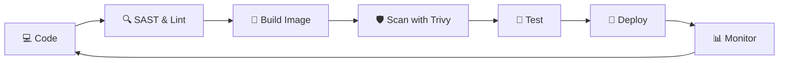

<div align="center">


<a href="https://git.io/typing-svg">
  
</a>

<br/>


[](https://linkedin.com/in/YOUR_LINKEDIN)
[](https://YOUR_PORTFOLIO_URL)
[](mailto:YOUR_EMAIL)

</div>

---

## 👨‍💻 About Me

```yaml
name: YOUR NAME
role: DevOps Engineer
focus: [DevSecOps, Cloud Security, CI/CD, Automation]
location: YOUR CITY, India 🇮🇳
currently_learning: [Kubernetes Security, Terraform, Threat Modeling]
open_to: [Collaboration, Open Source, Interesting Challenges]
philosophy: "Ship fast. Ship secure. Automate the rest."
```

- 🔭 Currently building **secure, automated delivery pipelines**
- 🛡️ Passionate about **cyber security**: vulnerability scanning, hardening, and secure-by-default infrastructure
- 🌱 Always learning something new in **cloud-native** and **security tooling**
- 💬 Ask me about **Docker, CI/CD, Linux, DevSecOps, Django deployments**
- ⚡ Fun fact: if I do something twice, I write a script for it

---

## 🧰 Tech Stack

### ⚙️ DevOps & Cloud
<p>
  
</p>

### 🔐 Cyber Security
<p>
  
  
  
  
  
  
  
</p>

### 💻 Languages & Frameworks
<p>
  
</p>

### 📊 Monitoring & Observability
<p>
  
</p>

---

## 🚀 Featured Projects

| Project | Description | Tech |
|---|---|---|
| 📝 **[Django Notes App](https://github.com/YOUR_USERNAME/django-notes-app)** | A Django notes application, containerized and deployed with a CI/CD pipeline | `Python` `Django` `Docker` `CI/CD` |
| 🌐 **[Portfolio Website](https://github.com/YOUR_USERNAME/portfolio)** | Responsive personal portfolio with dark/light mode | `HTML` `CSS` `JavaScript` |
| 🛡️ **[Project Name](https://github.com/YOUR_USERNAME/REPO)** | Short description of a security or DevOps project | `Tech` `Tech` |
| ⚙️ **[Project Name](https://github.com/YOUR_USERNAME/REPO)** | Short description of an automation or IaC project | `Tech` `Tech` |

---

## 🔄 My DevSecOps Workflow



---

## 📈 GitHub Stats

<div align="center">


</div>

---

## 🏆 Goals & Certifications

- [ ] Certified Kubernetes Administrator (CKA)
- [ ] AWS Certified Solutions Architect / Security Specialty
- [ ] CompTIA Security+ / CEH
- [ ] HashiCorp Terraform Associate
- [x] Built and shipped end-to-end CI/CD for a Django app

---

## 🤝 Let's Connect

I'm open to collaborating on **DevOps automation**, **DevSecOps tooling**, and **open-source security projects**.

<div align="center">

[](https://linkedin.com/in/YOUR_LINKEDIN)
[](https://twitter.com/YOUR_HANDLE)
[](https://dev.to/YOUR_HANDLE)
[](https://medium.com/@YOUR_HANDLE)

<br/>

> *"Security is not a product, but a process."* — Bruce Schneier


</div>
